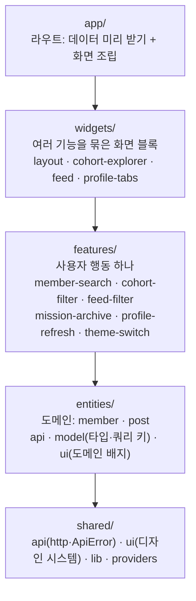

# 아키텍처 (@who-tech/web)

우아한테크코스 크루 검색 서비스(who.tech)의 웹. 크루 검색, 기수별 목록, 블로그 피드, 크루 상세(미션 PR·블로그 글)를 보여 준다.

- Next.js 15 App Router · React 19 · TanStack Query · Tailwind v4 · cva
- 백엔드·어드민은 [who-tech-backend](https://github.com/iftype/who-tech-backend) (같은 형식의 `ARCHITECTURE.md`)

## 계층

- 화살표 방향으로만 import한다. 같은 층끼리도 금지 (기능 → 다른 기능 ✕). 엔티티끼리는 공개 진입점(`index.ts`)으로만
- 규칙은 dependency-cruiser가 CI(Web quality gate)에서 실패로 막는다: `pnpm --filter @who-tech/web deps:check`
- 왜 이 구조인가 → [ADR 0001](docs/adr/0001-layers.md)

### 데이터

- 서버 호출은 `shared/api`(`requestJson`, `withQuery`, `ApiError`, `RateLimitError`)를 거쳐 엔티티의 API 함수(`memberApi`, `postApi`)로만 한다
- 캐시 키는 엔티티의 팩토리(`memberKeys`, `postKeys`)만 쓴다. 서버 컴포넌트가 미리 받은 데이터(`initialData`·prefetch)와 클라이언트 쿼리가 같은 키를 쓰게 하기 위해서다

### 이름 규칙

| 이름             | 뜻                                                                                                                                           |
| ---------------- | -------------------------------------------------------------------------------------------------------------------------------------------- |
| `*Client.tsx`    | 서버 `page.tsx`가 미리 받은 데이터를 넘겨 그리는 `'use client'` 뿌리. 페이지마다 하나 (`MemberDetailClient`, `SettingsClient`, `FeedClient`) |
| `use*`           | 훅. 화면에서 데이터·URL 상태를 떼어 낸 것 (`useCohortUrlState`, `useFeedPosts`)                                                              |
| `*Api` / `*Keys` | 엔티티의 서버 호출 함수 묶음 / 쿼리 키 팩토리                                                                                                |
| `*Variants`      | `shared/ui`의 cva 클래스 함수. `button`·`a`·`Link` 어디에나 붙인다                                                                           |
| `*Skeleton`      | 데이터가 오기 전 같은 자리를 차지하는 뼈대                                                                                                   |

## 디자인 시스템 (`shared/ui`)

| 종류        | 부품                                                                                                                                                                      |
| ----------- | ------------------------------------------------------------------------------------------------------------------------------------------------------------------------- |
| 누르는 요소 | `buttonVariants`, `chipButtonVariants`, `tabVariants`·`pageTabVariants`, `segmentVariants`, `optionVariants`, `filterChipVariants`, `listItemVariants`, `navLinkVariants` |
| 묶음·틀     | `TabBar`, `SegmentedControl`, `OptionGroup`, `FilterRow`, `PageContainer`                                                                                                 |
| 표시        | `Badge`(tone), `Avatar`, `Divider`, `SectionLabel`                                                                                                                        |

- 모든 variant는 cva. `button`·`a`·`Link` 어디에나 붙도록 클래스 함수로 준다
- 글자 크기는 `@theme` 스케일(`text-caption`, `text-body` …), 색은 의미 토큰(`text-danger`, `text-track-frontend` …)만
- 누르는 요소의 모양은 한 화면에서만 쓰여도 `shared/ui`에 둔다. 버튼 모양을 한곳에서 보고 바꾸기 위해서다
- `pnpm lint:tokens`(CI 실패 처리)가 막는 것: 임의 px 글자 크기, 원시 팔레트 색, `shared/ui` 밖에서 `<button>` 모양 직접 지정
- 자세한 목록과 규칙: [`src/shared/ui/AGENTS.md`](src/shared/ui/AGENTS.md), 결정 → [ADR 0003](docs/adr/0003-design-system.md)

## 새 기능을 추가하는 방법

1. 도메인 데이터가 새로 필요하면 `entities/<도메인>/`에 타입(`model`)·API 함수(`api`)·쿼리 키를 둔다
2. 사용자 행동 하나(필터, 검색, 새로고침)는 `features/<기능>/`에 만든다. 다른 기능의 코드가 필요하면 엔티티나 shared로 내린다
3. 여러 기능을 한 화면 블록으로 묶을 때만 `widgets/`를 쓴다
4. `app/<라우트>/page.tsx`는 데이터를 미리 받고 위젯·기능을 조립만 한다
5. 버튼·탭·칩 모양이 필요하면 `shared/ui`의 variant를 쓰고, 없으면 거기에 추가한다

## 바꿔도 안전한지 확인하는 장치

| 장치             | 무엇을 고정하나                                                                | 위치                                        |
| ---------------- | ------------------------------------------------------------------------------ | ------------------------------------------- |
| 스크린샷 비교    | 주요 화면 38장(라이트·다크) 픽셀 비교. 녹화·익명화한 API 응답과 고정 시각 사용 | `e2e/visual`, `playwright.visual.config.ts` |
| variant 테스트   | 화면에서 옮긴 클래스가 원래 문자열과 같은 집합인지                             | `src/shared/ui/variants.test.ts`            |
| 단위·통합 테스트 | API 계층, 피드·기수 화면 렌더링, 검색 (커버리지 래칫)                          | `src/**/*.test.ts(x)`                       |
| 스테이징         | 런타임 변경은 `develop`(Vercel 프리뷰)에서 먼저 확인                           | 루트 `CLAUDE.md`                            |
| 뮤테이션 테스트  | 테스트가 실제로 버그를 잡는지 (주간)                                           | `stryker.config.mjs`                        |

→ [ADR 0002](docs/adr/0002-visual-regression.md)

## 구조 개선 전후 (2026-10-19)

같은 측정 스크립트를 개선 전 커밋(`9c0a51a`)과 후 커밋에 돌린 값.

| 항목                            | 전                                                   | 후                                            |
| ------------------------------- | ---------------------------------------------------- | --------------------------------------------- |
| 계층 의존 규칙                  | 없음 (`ui/`에 도메인 배지, layout → features 역방향) | 5개 층, 위반 0 (CI 실패 처리)                 |
| 쿼리 키 문자열 직접 사용        | 6                                                    | 0 (`memberKeys`·`postKeys`)                   |
| 임의 px 글자 크기 `text-[Npx]`  | 148                                                  | 0 (`@theme` 스케일)                           |
| 원시 팔레트 색                  | 23                                                   | 0 (의미 토큰)                                 |
| 모양을 직접 지정한 `<button>`   | 19                                                   | 0 (`shared/ui` variant, CI 실패 처리)         |
| 같은 className 반복 (종류 / 곳) | 48 / 127                                             | 31 / 78 (배치·글자 스타일만)                  |
| 가장 큰 컴포넌트                | 342줄 (CohortExplorer, 훅 14개)                      | 199줄 (CohortExplorer는 121줄)                |
| API 계층                        | 쿼리스트링 코드 3중 복붙, 일반 객체 throw            | `withQuery` 하나, `ApiError`·`RateLimitError` |

## 결정 기록

- [0001 계층 구조 (app → widgets → features → entities → shared)](docs/adr/0001-layers.md)
- [0002 스크린샷 비교를 구조 변경의 안전망으로](docs/adr/0002-visual-regression.md)
- [0003 디자인 시스템: cva variant와 토큰, 누르는 요소는 모두 shared/ui](docs/adr/0003-design-system.md)
