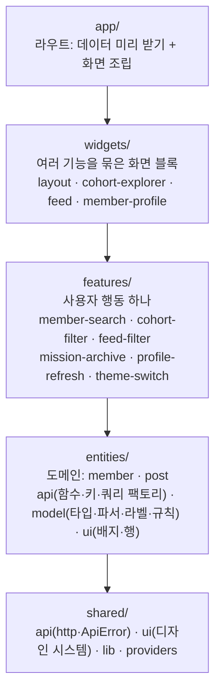

# 아키텍처 (@who-tech/web)

우아한테크코스 크루 검색 서비스(who.tech)의 웹. 크루 검색, 기수별 목록, 블로그 피드, 크루 상세(미션 PR·블로그 글)를 보여 준다.

- Next.js 15 App Router · React 19 · TanStack Query · Tailwind v4 · cva
- 백엔드·어드민은 [who-tech-backend](https://github.com/iftype/who-tech-backend) (같은 형식의 `ARCHITECTURE.md`)

## 계층

- 화살표 방향으로만 import한다. 같은 층끼리도 금지 (기능 → 다른 기능 ✕, 위젯 → 다른 위젯 ✕). 엔티티·기능·위젯은 바깥에서 공개 진입점(`index.ts`)으로만 참조한다 — 안쪽 파일 구조를 바꿔도 바깥이 깨지지 않는다
- 규칙은 dependency-cruiser가 CI(Web quality gate)에서 실패로 막는다: `pnpm --filter @who-tech/web deps:check`
- 왜 이 구조인가 → [ADR 0001](docs/adr/0001-layers.md)

### 데이터

- 서버 호출은 `shared/api`(`requestJson`, `withQuery`, `ApiError`, `RateLimitError`)를 거쳐 엔티티의 API 함수(`memberApi`, `postApi`)로만 한다
- 쿼리 옵션은 엔티티의 `*.queries.ts`(`feedQuery`, `cohortMembersQuery`, `cohortsQuery`, `memberDetailQuery`, `memberSearchQuery`, `memberPostsQuery`)에 한 번만 정의한다. 서버 `page.tsx`의 prefetch, 화면의 `useQuery`, 미리 받기가 같은 옵션을 써서 키·캐시 모양이 어긋날 수 없다. 키는 `['members', …]`·`['posts', …]` 네임스페이스로 시작한다 → [ADR 0006](docs/adr/0006-query-keys-and-factories.md)
- 첫 데이터는 props가 아니라 캐시로 넘긴다: 요청마다 새 `QueryClient` → prefetch → `dehydrate` → `<HydrationBoundary>`. 실패한 prefetch는 넘어가지 않아 화면이 다시 받는다 → [ADR 0004](docs/adr/0004-rendering-and-hydration.md)
- URL 상태(필터·탭)는 `shared/lib/urlStore`(`useSyncExternalStore`)로 URL에서 계산한다 → [ADR 0005](docs/adr/0005-url-as-external-store.md). URL·쿠키 값은 그 값을 아는 층의 파서(`parseTrack`, `parseCohortNumber`, `parseProfileTab`, `parseTheme` …)로만 읽는다 → [ADR 0007](docs/adr/0007-url-parsers-and-profile-tabs.md)
- 도메인 사실(트랙·역할 이름, 운영진 판별, 현재 기수, GitHub 주소)은 `entities/member/model`에만 있고 UI는 읽는다. 같은 의미의 UI는 공용 컴포넌트 하나로 → [ADR 0008](docs/adr/0008-component-composition.md)
- 도메인 **규칙**(크루/운영진 판별, 배지 선택, 트랙 색, 블로그 플랫폼, 경로)도 엔티티에. 화면마다 `*Location.ts`에 URL 파서·빌더, 훅은 `{ initial* }` 객체 인자. 링크 모양도 `shared/ui/linkVariants`, `className`은 배치만 → [ADR 0010](docs/adr/0010-domain-rules-url-locations-and-link-variants.md)

### 이름 규칙

| 이름             | 뜻                                                                                                                                             |
| ---------------- | ---------------------------------------------------------------------------------------------------------------------------------------------- |
| `*Client.tsx`    | 서버 `page.tsx`가 캐시로 넘긴 데이터를 읽어 그리는 `'use client'` 뿌리. 페이지마다 하나 (`MemberDetailClient`, `SettingsClient`, `FeedClient`) |
| `index.ts`       | 슬라이스(엔티티·기능·위젯)의 공개 진입점. 바깥은 이것으로만 import한다                                                                         |
| `parse*`         | URL·쿠키 문자열 → 도메인 값. 모르는 값은 기본값 (`parseCohortNumber`, `parseProfileTab`, `parseTheme`)                                         |
| `use*`           | 훅. 화면에서 데이터·URL 상태를 떼어 낸 것 (`useCohortUrlState`, `useFeedPosts`)                                                                |
| `*Api` / `*Keys` | 엔티티의 서버 호출 함수 묶음 / 쿼리 키 팩토리                                                                                                  |
| `*Variants`      | `shared/ui`의 cva 클래스 함수. `button`·`a`·`Link` 어디에나 붙인다                                                                             |
| `*Skeleton`      | 데이터가 오기 전 같은 자리를 차지하는 뼈대                                                                                                     |

## 디자인 시스템 (`shared/ui`)

| 종류        | 부품                                                                                                                                                                      |
| ----------- | ------------------------------------------------------------------------------------------------------------------------------------------------------------------------- |
| 누르는 요소 | `buttonVariants`, `chipButtonVariants`, `tabVariants`·`pageTabVariants`, `segmentVariants`, `optionVariants`, `filterChipVariants`, `listItemVariants`, `navLinkVariants` |
| 묶음·틀     | `TabBar`, `SegmentedControl`, `OptionGroup`, `FilterRow`, `PageContainer`, `ListCard`(stack), `EmptyState`(frame·size)                                                    |
| 표시        | `Badge`(tone), `Avatar`, `Divider`, `SectionLabel`, `icons/`(인라인 SVG 원문 — 라이브러리로 바꾸면 픽셀이 바뀐다)                                                         |

- 모든 variant는 cva. `button`·`a`·`Link` 어디에나 붙도록 클래스 함수로 준다
- 글자 크기는 `@theme` 스케일(`text-caption`, `text-body` …), 색은 의미 토큰(`text-danger`, `text-track-frontend` …)만
- 누르는 요소의 모양은 한 화면에서만 쓰여도 `shared/ui`에 둔다. 버튼 모양을 한곳에서 보고 바꾸기 위해서다
- `pnpm lint:tokens`(CI 실패 처리)가 막는 것: 임의 px 글자 크기, 원시 팔레트 색, `shared/ui` 밖에서 `<button>` 모양 직접 지정
- 자세한 목록과 규칙: [`src/shared/ui/AGENTS.md`](src/shared/ui/AGENTS.md), 결정 → [ADR 0003](docs/adr/0003-design-system.md)

## 새 기능을 추가하는 방법

1. 도메인 데이터가 새로 필요하면 `entities/<도메인>/`에 타입(`model`)·API 함수(`api`)·쿼리 키를 둔다
2. 사용자 행동 하나(필터, 검색, 새로고침)는 `features/<기능>/`에 만든다. 다른 기능의 코드가 필요하면 엔티티나 shared로 내린다
3. 여러 기능을 한 화면 블록으로 묶을 때만 `widgets/`를 쓴다
4. `app/<라우트>/page.tsx`는 데이터를 미리 받고 위젯·기능을 조립만 한다
5. 버튼·탭·칩 모양이 필요하면 `shared/ui`의 variant를 쓰고, 없으면 거기에 추가한다

## 테스트 하네스 (`src/test/`)

- `renderHydrated(ui, { seed })`: 서버 page.tsx처럼 서버 캐시에 넣고 `dehydrate` → `HydrationBoundary`. `renderWithQuery`, URL 헬퍼(`setUrl`·`popstateTo`), 픽스처(`makeMember`·`makeFeedItem` …)
- 리팩토링 PR은 동작 고정 테스트를 **먼저** 쓴다(옛 코드로 통과 → 새 코드로 통과). 분해할 컴포넌트는 분해 전에 DOM 스냅샷(`FeedRow`·`MemberDetailClient`·`Navbar`)을 찍어 둔다. 클래스는 집합으로 비교한다 → [ADR 0009](docs/adr/0009-test-harness-and-quality-gates.md)

## 바꿔도 안전한지 확인하는 장치

| 장치             | 무엇을 고정하나                                                                | 위치                                                                              |
| ---------------- | ------------------------------------------------------------------------------ | --------------------------------------------------------------------------------- |
| 스크린샷 비교    | 주요 화면 38장(라이트·다크) 픽셀 비교. 녹화·익명화한 API 응답과 고정 시각 사용 | `e2e/visual`, `playwright.visual.config.ts`                                       |
| variant 테스트   | 화면에서 옮긴 클래스가 원래 문자열과 같은 집합인지                             | `src/shared/ui/variants.test.ts`                                                  |
| 단위·통합 테스트 | API 계층, 화면 렌더링·URL·탭, 파서, 훅 (커버리지 래칫 lines 93 / functions 93) | `src/**/*.test.ts(x)`, `src/test/`                                                |
| 경계·규칙 린트   | 계층 역방향, 슬라이스 안쪽 깊은 import, 위젯끼리 참조, import 순서, 토큰       | `.dependency-cruiser.cjs`, `eslint.config.mjs`, `scripts/check-design-tokens.mjs` |
| WebView 계약     | 모바일 앱이 읽는 셀렉터(`header[data-nav]` 등)                                 | `src/widgets/layout/Navbar.test.tsx`                                              |
| 스테이징         | 런타임 변경은 `develop`(Vercel 프리뷰)에서 먼저 확인                           | 루트 `CLAUDE.md`                                                                  |
| 뮤테이션 테스트  | 테스트가 실제로 버그를 잡는지 (주간)                                           | `stryker.config.mjs`                                                              |

→ [ADR 0002](docs/adr/0002-visual-regression.md)

## 구조 개선 전후 (2026-10-19)

같은 측정 스크립트를 개선 전 커밋(`9c0a51a`)과 후 커밋에 돌린 값.

| 항목                            | 전                                                   | 후                                            |
| ------------------------------- | ---------------------------------------------------- | --------------------------------------------- |
| 계층 의존 규칙                  | 없음 (`ui/`에 도메인 배지, layout → features 역방향) | 5개 층, 위반 0 (CI 실패 처리)                 |
| 쿼리 키 문자열 직접 사용        | 6                                                    | 0 (`memberKeys`·`postKeys`)                   |
| 임의 px 글자 크기 `text-[Npx]`  | 148                                                  | 0 (`@theme` 스케일)                           |
| 원시 팔레트 색                  | 23                                                   | 0 (의미 토큰)                                 |
| 모양을 직접 지정한 `<button>`   | 19                                                   | 0 (`shared/ui` variant, CI 실패 처리)         |
| 같은 className 반복 (종류 / 곳) | 48 / 127                                             | 31 / 78 (배치·글자 스타일만)                  |
| 가장 큰 컴포넌트                | 342줄 (CohortExplorer, 훅 14개)                      | 199줄 (CohortExplorer는 121줄)                |
| API 계층                        | 쿼리스트링 코드 3중 복붙, 일반 객체 throw            | `withQuery` 하나, `ApiError`·`RateLimitError` |

## 리팩토링 라운드 3 전후 (2026-10-21)

면접에서 설명할 수 있는 코드를 목표로, 화면은 1px도 바꾸지 않고(스크린샷 38장 0픽셀, fixture·baseline 변경 0) 함수·컴포넌트 안쪽을 정리했다. PR #106–#118.

| 항목                                                  | 전                     | 후                                                         |
| ----------------------------------------------------- | ---------------------- | ---------------------------------------------------------- |
| 엔티티 밖 인라인 `useQuery` / 네임스페이스 밖 쿼리 키 | 2 / 2                  | 0 / 0                                                      |
| `useState`로 복사한 탭 상태 / 파서 없는 URL·쿠키 값   | 2 / 5종                | 0 / 0                                                      |
| 역할 배지 복사 / 트랙 라벨 리터럴 / 인라인 SVG        | 4 / 3 / 8              | 0 / 1 / 0                                                  |
| 줄 수: Navbar · MemberDetailClient · ProfileTabs      | 178 · 123 · 122        | 77 · 35 · 57                                               |
| 줄 수: SearchDropdown · useMemberSearch               | 134 · 97               | 105 · 58                                                   |
| 테스트 파일 / 케이스 / 커버리지(lines·functions)      | 18 / 114 / 78.0 · 78.9 | 50 / 217 / 94.2 · 94.0                                     |
| CI가 막는 규칙                                        | 계층 역방향, 토큰      | + 슬라이스 index 경계, 위젯 교차, import 순서, 깊은 import |

## 리팩토링 라운드 4 전후 (2026-10-21)

라운드 3 뒤 전수 감사로 찾은 것을 닫았다. 동작 버그 3건(#120)과 리팩토링 4개(#121–#124). 화면 0픽셀.

| 항목                                                                | 전               | 후               |
| ------------------------------------------------------------------- | ---------------- | ---------------- |
| 기수 탭에서 빠지던 글(대표 기수 ≠ 참여 기수) / 설정 SSR 탭 깜빡임   | 있음 / 있음      | 0 / 0            |
| UI 안의 도메인 규칙(역할 판별·배지 선택·트랙 색·출처·경로)          | 7                | 0 (entities)     |
| URL 훅 모양(객체 인자·`*Location.ts`)                               | 4개 제각각       | 4개 같음         |
| 모양을 리터럴로 쓴 링크 / 토큰 린트 대상                            | 15 / 버튼        | 0 / 버튼+링크    |
| `className`으로 모양을 덧대는 탈출구(Avatar·SearchDropdown·NavLink) | 3                | 0                |
| 바깥에서 아무도 쓰지 않는 export                                    | 21               | 0                |
| 테스트 파일 / 케이스 / 래칫                                         | 50 / 217 / 93·93 | 60 / 246 / 93·93 |

## 리팩토링 라운드 5 전후 (2026-10-22)

라운드 3·4가 "하지 않은 것"으로 남긴 것을 닫았다 (#126 · #127). 화면 0픽셀.

| 항목                                                        | 전            | 후                         |
| ----------------------------------------------------------- | ------------- | -------------------------- |
| 요청 실패가 "없습니다"로 보이던 화면(피드·기수·블로그·검색) | 4             | 0 (`ErrorState`·다시 시도) |
| 화면의 `roles ?? []` 방어                                   | 1             | 0 (API 계층 정규화)        |
| 서버 데이터 캐시 없는 서버 prefetch                         | 1 (`cohorts`) | 0                          |

## 결정 기록

- [0001 계층 구조 (app → widgets → features → entities → shared)](docs/adr/0001-layers.md)
- [0002 스크린샷 비교를 구조 변경의 안전망으로](docs/adr/0002-visual-regression.md)
- [0003 디자인 시스템: cva variant와 토큰, 누르는 요소는 모두 shared/ui](docs/adr/0003-design-system.md)
- [0004 렌더링·캐시: 동적 렌더링 + 서버 prefetch 하이드레이션](docs/adr/0004-rendering-and-hydration.md)
- [0005 URL은 외부 저장소 (useSyncExternalStore)](docs/adr/0005-url-as-external-store.md)
- [0006 서버 상태의 모양은 엔티티에 한 번만 (키 네임스페이스·쿼리 팩토리·http 경계)](docs/adr/0006-query-keys-and-factories.md)
- [0007 URL 값은 파서로만 읽고, 탭 상태의 주인은 URL 하나](docs/adr/0007-url-parsers-and-profile-tabs.md)
- [0008 컴포넌트 합성: 같은 의미는 하나로, props는 의미를 말한다](docs/adr/0008-component-composition.md)
- [0009 테스트 하네스와 품질 게이트](docs/adr/0009-test-harness-and-quality-gates.md)
- [0010 도메인 규칙은 엔티티에, URL 모양은 Location 모듈에, 링크 모양도 variant로](docs/adr/0010-domain-rules-url-locations-and-link-variants.md)
- [0011 실패는 실패라고 말한다, 데이터 모양은 경계에서 정한다](docs/adr/0011-error-states-and-data-boundary.md)
